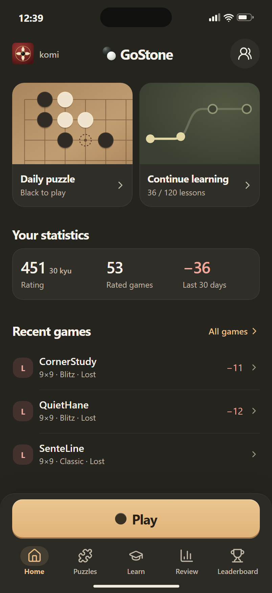

# GoStone iPhone home preview

Warm charcoal surfaces, a wood board crop and one honey-colored primary action. The two practice modules share a common layout. Statistics sit in one compact group, followed by the recent games and the fixed Play and navigation area.

Run `npx vite --config vite.home-preview.config.mts` to open the standalone preview. `npx vite build --config vite.home-preview.config.mts` outputs to `dist/home-preview`.

The signed-in preview uses fictitious names, sample data and an illustrative board position. The game rows open sample details. The other links point to the corresponding GoStone website routes.

Verified in Chromium and WebKit at 402 × 874, 360 × 740 and 320 × 640. The screenshot comes from a browser on Windows at twice the logical resolution. iPhone system chrome is simulated.
