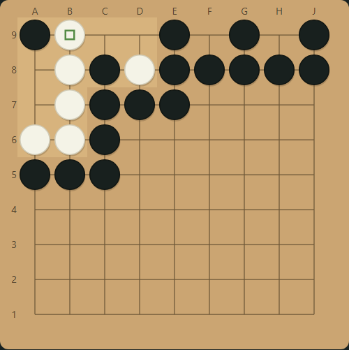
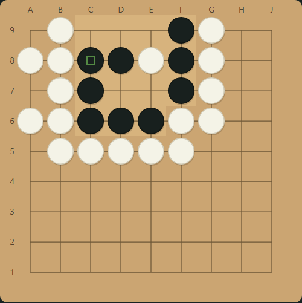
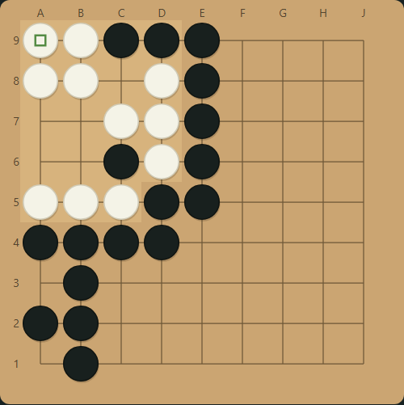
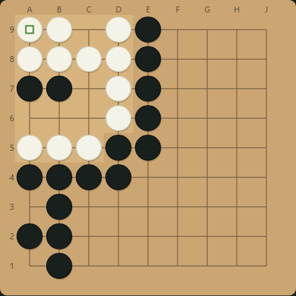

# Prüfung der tatsächlich erzeugten Diagramme

14.10.2026, lokales Puzzle Lab. Ausgangspunkt war die Nutzerkritik an fast
vollständig gefüllten schwarzen/weißen Rechtecken. Die vorherigen 125
Lab-Aufgaben und der alte Lauf wurden entfernt. Diese Erzeugungsform ist
abgelöst; mathematische Zertifikate allein waren kein ausreichendes Urteil
über die Qualität der dargestellten Aufgaben.

## Vorgehen und gefundene Fehler

Die erste kompakte Probe enthielt zwölf vierzügige Aufgaben. Die Bilder wurden
aus der tatsächlichen Lab-Oberfläche aufgenommen, korrekte Lösungen und beide
kurzen Fehlerwege im Browser ausgespielt. Dabei zeigten sich weiterhin Gruppen
mit fast gleicher Form. Ein Fehlerweg verlangte außerdem einen eigenen Pass,
der in der Oberfläche nicht spielbar war. Nach einem Serverneustart fehlten
Lösungszugmuster im Duplikatindex, weil der Katalog sie nicht gespeichert hatte.

Diese Befunde führten zu drei weiteren Korrekturen: Vergleich der tatsächlichen
Zielgruppenformen unabhängig von Umgebung/Farbe/Ausrichtung; dauerhafte
Lösungsmuster und Nachladen älterer Katalogeinträge; kurze Fehlerwege aus
spielbaren eigenen Steinsetzungen, ohne Pass-Verlängerung. Acht wiederkehrende
Prototypen wurden entfernt. Die nächste Bildserie enthielt weiterhin zu dichte
Randstellungen mit 35–36 Steinen. Auch diese bestanden mathematische Prüfungen,
waren optisch aber nicht gut genug und wurden entfernt.

Danach wurden die Umgebungen nochmals reduziert: zwei zusätzliche Randsteine
für zwei echte Augen bzw. eine dünne zweireihige Fortsetzung in der Ecke. Bis
vier eigene Züge werden nur noch Diagramme mit höchstens 28 Gesamtsteinen
erzeugt. Der Vergleich nahe verwandter Zielgruppen richtet die Formen an allen
möglichen inneren Punkten aus; ein angefügter Stein darf die alte Kernform nicht
durch eine verschobene Begrenzungsbox verstecken. Bei der Suche werden nun auch
weiße Steine an der tatsächlichen Kampfgrenze verändert. Ihre frühere Sperre
hatte den Zielgruppen-Umriss eingefroren. Wiederkehrende Prototypen wurden
erneut entfernt, behaltene Aufgaben auf die minimale Darstellung umgestellt.

## Angesehene Bildserie

Die abschließende dokumentierte Probe umfasst elf Aufgaben: 1–3 und 7–14.
Jede Startstellung, die erste gespielte Gegenwehr und eine Fehler-Endstellung
wurde auf dem Kontaktbogen angesehen; zusätzlich wurden die vollständige
Lösung und beide Fehlerfolgen tatsächlich ausgespielt. Alle Aufgaben benötigen
vier eigene Züge gegen beste geprüfte Gegenwehr. Die Rohbilder und der
Browserbericht liegen lokal unter `.cache/final-visual-review/`.

| Beispiel | Bildbefund | Bewertung für das Format |
| --- | --- | --- |
| 1 | Fünf Zielsteine links oben. Schwarz beginnt A8, Weiß verteidigt C9. In der ausgespielten Lösung folgen Opfer und Rückfang; ein Fehler lässt zwei getrennte Augen entstehen. | Erkennbares Augen-/Opferproblem mit echter Ecke; kein gefüllter Rechteckrahmen. |
| 3 | Randgruppe mit sechs Zielsteinen. Weiß beginnt E7; die schwarze Antwort D9 wurde tatsächlich gespielt. Zwei kleine Randaugen sichern die umgebende weiße Kette. | Tatsächlich andere Zugfarbe und Randkontext; Abtrennen/Fangen statt bloßer Farbkopie von Beispiel 1. |
| 7 | Vier Zielsteine in einer quadratischen Eckgruppe, weitere weiße Gruppen sind getrennt. Schwarz B6 und Weiß A7 beeinflussen deren mögliche Verbindung. | Das Einzelbild zeigt mehrere beteiligte Gruppen und einen anderen Lösungskern. |
| 11 | Neun Zielsteine in einer verzweigten Eckstellung. Schwarz C6, Weiß B6; Verbindung und Freiheiten sind entscheidend. | Größere Lesestellung mit anderer Gruppengeometrie bei weiterhin kleinem Diagramm. |

Die Probe hat insgesamt 23–28 Steine pro Brett und Zielgruppen mit 4–11
Steinen. Die wesentliche Verbesserung ist nicht bloß diese Zahl: echte
Brettkanten, dünne verbundene Umgebung, sichtbar verschiedene Zielgruppen und
tatsächlich ausgespielte Widerlegungen ersetzen die künstliche geschlossene
Massenwand. Es gibt weiterhin eine gemeinsame Aufgabenklasse, lokale
Fang-/Augenprobleme. Diese Prüfung belegt weder eine breite Abdeckung aller
Go-Themen noch professionell kalibrierte Kyu-Ränge oder die didaktische Güte
zukünftiger, noch nicht angesehener Aufgaben. Freigabe bleibt eine bewusste
Einzelprüfung; der gemeinsame Export enthält nur freigegebene Aufgaben.

Die unabhängige Vollbrettprüfung vergleicht zusätzlich jede Zwischenstellung
mit der bestehenden Go-Regelengine, alle Fang-/Lebens-Endpunkte und die
Verbindung sämtlicher Umgebungssteine mit der nachweisbar lebenden Kette.
Alle elf behaltenen Aufgaben bestanden die erneute Suche und insgesamt
2.158 unabhängige Vollbrett-Prüfknoten. Der Browser-Neustarttest bestätigt
außerdem erneuerte Sitzung, weiß beginnenden JSON-/SGF-Export und ein mobiles
Layout ohne horizontales Überlaufen.
Neue Tests decken echte Randaugen, fehlende künstliche Wandimmunität,
kompakte Eck-/Randstellungen mit beiden Umgebungsverläufen, beide Startfarben,
spielbare Fehlerwege und den Duplikatindex nach Neustart ab.
